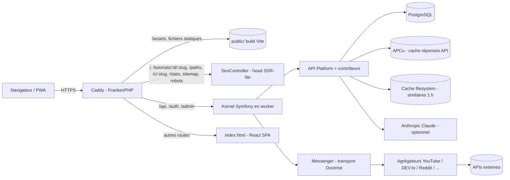
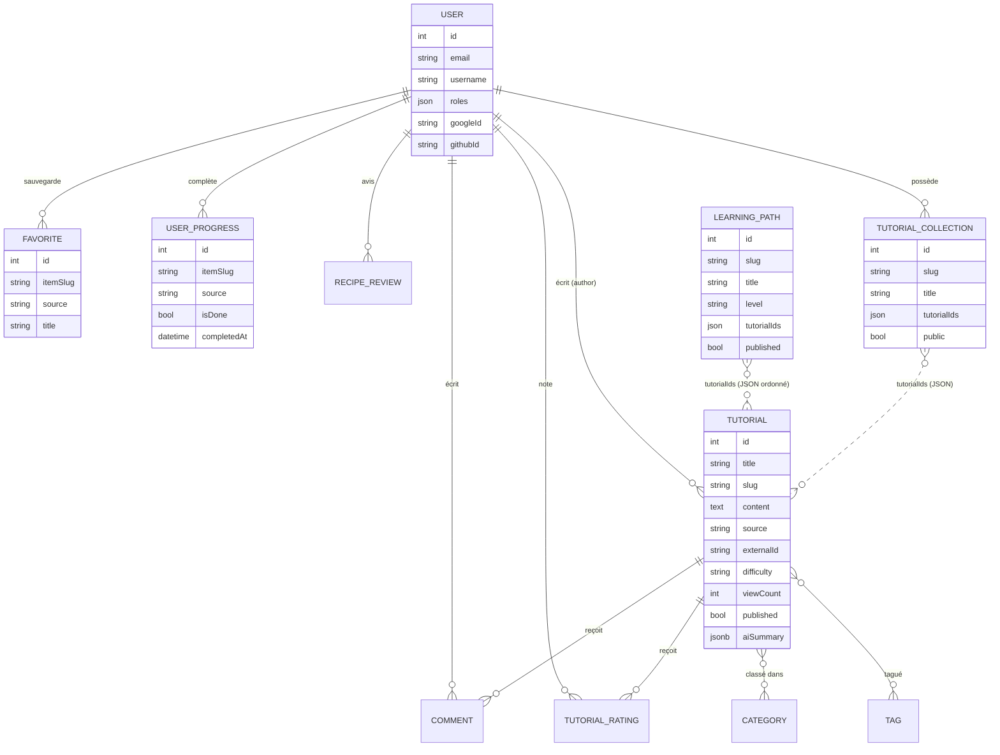

# YourTuto, documentation technique

> Branche de référence : `staging` (commit `1de681a`, 14 octobre 2026). Toutes les versions viennent de `composer.json`/`composer.lock` et `frontend/package.json`/`package-lock.json`.

## 1. Pitch et fonctionnalités

**YourTuto** regroupe les meilleurs tutoriels du web en **un seul flux** : vidéos YouTube, articles DEV.to et Medium, posts Reddit, Archive.org, Instructables, recettes (Spoonacular, TheMealDB) et tutos écrits par la communauté. Par rapport à daily.dev, Class Central, roadmap.sh ou freeCodeCamp, l'idée est d'ajouter du **suivi d'apprentissage** (parcours, progression, streaks) par-dessus une **agrégation multi-sources**.

Fonctionnalités :
- Catalogue multi-sources avec recherche, recherche live YouTube, filtres par niveau et popularité, et pages catégorie.
- Comptes : email et mot de passe, OAuth Google et GitHub, profil, avatar, mot de passe oublié par email.
- Favoris, progression (fait / à faire), notes de 1 à 5, commentaires, avis sur les recettes.
- Création de tutos en Markdown (éditeur `@uiw/react-md-editor`).
- **Parcours d'apprentissage** (`/paths`) avec barre de progression.
- **Streaks, stats perso, heatmap sur 84 jours et badges** (`/my-progress`).
- **Résumé TL;DR** de chaque tuto : IA en option, extraction gratuite par défaut.
- **Tutos similaires** calculés par un score de contenu explicable.
- **Collections publiques partageables** (`/c/:slug`).
- Recommandations personnalisées par IA (si une clé est configurée).
- Page publique `/stats` sur le catalogue, SEO complet (sitemap, robots, Open Graph, JSON-LD), PWA installable.
- Back-office EasyAdmin (`/admin`).

## 2. Stack technique

| Couche | Techno | Version |
|---|---|---|
| Langage back | PHP | 8.4 (image Docker / CI), contrainte `>=8.2` |
| Framework back | Symfony | 7.4 (framework-bundle 7.4.20) |
| API REST | API Platform | 4.4.4 |
| ORM | Doctrine ORM / DoctrineBundle / Migrations | 3.7.5 / 3.3.2 / 4.x |
| Back-office | EasyAdmin | 5.6.1 |
| Templates | Twig | 3.30 |
| Auth API | LexikJWTAuthenticationBundle | 3.2.0 |
| OAuth | knpuniversity/oauth2-client-bundle 2.20.2, league/oauth2-google 4.2.0, league/oauth2-github 3.1.1 | |
| CORS | NelmioCorsBundle | 2.6.1 |
| Async | Symfony Messenger (transport Doctrine, file `failed`) | 7.4 |
| Mails | Symfony Mailer + Google Mailer | 7.4 |
| IA | anthropic-ai/sdk, modèle `claude-haiku-4-5` | 0.6.0 |
| Redis (client) | predis/predis | 3.7.0 |
| Langage front | TypeScript | 5.9.3 |
| UI | React / React DOM | 19.2.4 |
| Routing | React Router DOM | 7.18.4 |
| Build | Vite (+ @vitejs/plugin-react 5) | 7.3.7 |
| CSS | Tailwind CSS (+ @tailwindcss/vite, typography) | 4.2.1 |
| État client | Zustand (persist) | 5.0.11 |
| Données serveur | TanStack React Query | 5.90.21 |
| HTTP | Axios | 1.20.0 |
| Markdown | react-markdown 10, remark-gfm 4, rehype-highlight 7, DOMPurify 3 | |
| Icônes | lucide-react | 0.577 |
| Base de données | PostgreSQL (SQL) | 16 en CI (`serverVersion=16`) |
| Serveur | FrankenPHP (Caddy) en mode worker | image `dunglas/frankenphp:php8.4-alpine` |
| Cache PHP | OPcache + JIT tracing, APCu | |
| Tests | PHPUnit 13.4.2 ; Vitest 5.0.4, Testing Library, jsdom | |
| Qualité | ESLint 9.39, typescript-eslint 8 | |
| Runtime build front | Node.js | 22 (`.nvmrc`, Dockerfile) |
| CI / hébergement | GitHub Actions / Railway | |

Langages : PHP, TypeScript/TSX, SQL (migrations Doctrine, DQL), Twig, YAML, CSS (Tailwind), Caddyfile, Dockerfile, Bash.

APIs externes, toutes optionnelles, chacune derrière sa variable d'env : **YouTube Data API** (`YOUTUBE_API_KEY`), **DEV.to** (`DEVTO_API_KEY`), **Reddit** (`REDDIT_CLIENT_ID/SECRET`), **Spoonacular** (`SPOONACULAR_API_KEY`), **TheMealDB**, **Medium** (RSS), **Archive.org**, **Instructables** et **Anthropic** (`ANTHROPIC_API_KEY`).

> Redis : `REDIS_URL` et predis sont présents, et un Redis tourne en CI, mais le cache applicatif actuel utilise le système de fichiers (`cache.adapter.filesystem`) et APCu. Redis est donc prêt mais pas encore branché comme pool de cache.

## 3. Architecture

### Cycle d'une requête
1. **Caddy** (dans FrankenPHP) reçoit la requête. Les fichiers statiques (`/assets/*`, avec un hash dans le nom) sont servis directement avec `Cache-Control: max-age=31536000, immutable`. `sw.js` est en `no-cache` et le manifest a le bon MIME.
2. Les routes `/api`, `/auth` et `/admin` vont à **Symfony**, qui tourne en **mode worker** (`worker.php`, 4 workers). Le kernel est démarré une seule fois et réutilisé entre les requêtes, donc pas de bootstrap à chaque requête.
3. Les autres routes renvoient `index.html` (le fallback de la SPA), puis React Router prend la main côté client.

### SEO « SSR-lite »
Une SPA classique renvoie un `<head>` vide aux robots. Dans YourTuto, une regex du Caddyfile (`@seo`) envoie les pages publiques (`/`, `/tutorials`, `/tutorials/{id}/{slug}`, `/paths[/slug]`, `/c/{slug}`, `/stats`, `/category/{source}`, `/sitemap.xml`, `/robots.txt`) vers `SeoController`. Le contrôleur :
- construit un `SeoMetadata` avec `SeoMetadataFactory` (title, description, canonical basé sur `SITE_URL`, Open Graph/Twitter, JSON-LD de type `Course`, `ItemList`, etc.) ;
- puis `HeadRenderer` injecte ces balises entre les marqueurs `<!--seo:start-->` et `<!--seo:end-->` de l'`index.html` buildé par Vite.

Le robot reçoit ainsi un HTML complet avec ses métadonnées, et l'utilisateur obtient la même SPA. Pas besoin de serveur Node ni de Next.js. Côté front, le composant `Seo.tsx` met aussi les balises à jour quand on navigue dans l'app. `/sitemap.xml` est généré dynamiquement à partir des tutos publiés, des parcours et des collections publiques.

### Cache
| Niveau | Mécanisme | Durée |
|---|---|---|
| Navigateur / CDN | `Cache-Control` d'API Platform (`shared_max_age`) | tutos 60 s, catégories et tags 300 s, commentaires 30 s |
| Réponses API | `ApiCacheSubscriber` stocke les GET anonymes dans **APCu** | `/api/tutorials` 90 s, `/api/categories` et `/api/tags` 300 s, `/api/comments` 30 s |
| Tutos similaires | Symfony Cache (filesystem), clé `related_{id}_{limit}` | 1 h |
| Résumés | colonne `ai_summary` (jsonb) en base | permanent |
| PHP | OPcache (sans `validate_timestamps`) + JIT | build |
| PWA | service worker : cache-first pour `/assets`, network-first avec repli hors ligne pour les navigations | version |

## 4. Modèle de données

Points notables :
- `Tutorial.source` est un enum PHP (`TutorialSource`) : community, youtube, devto, reddit, medium, recipe, instructables, generated, dev. Il y a des index sur `source`, `createdAt` et `(source, createdAt)`.
- `Favorite` et `UserProgress` sont **polymorphes** grâce à `(itemSlug, source)`, avec une contrainte unique `(user_id, item_slug, source)`. On peut ainsi suivre une vidéo YouTube ou un post Reddit sans l'importer en base.
- `TutorialRating` a une contrainte unique `(user_id, tutorial_id)`, et `RecipeReview` une contrainte unique `(author_id, spoonacular_id)`.
- Parcours et collections stockent une **liste ordonnée d'IDs en JSON** : l'ordre est gratuit et il n'y a pas de table de jointure à maintenir.
- `user` est une table entre guillemets, parce que c'est un mot réservé en PostgreSQL.
- Migrations : `Version20261013000000` (schéma initial, idempotent sur une base vide comme sur la base existante), puis streaks/parcours, résumés (`ai_summary` en jsonb) et collections.

## 5. Principaux endpoints API

| Méthode | Route | Rôle | Accès |
|---|---|---|---|
| POST | `/api/register`, `/api/login` | inscription, login (renvoie un JWT) | public, rate-limité |
| GET | `/auth/{google,github}/redirect` et `/callback` | OAuth | public |
| POST | `/api/forgot-password`, `/api/reset-password` | reset par email | public |
| GET/PATCH | `/api/me`, `/api/me/password`, `/api/me/picture` | profil | connecté |
| GET/POST/PATCH/DELETE | `/api/tutorials[/{id}]` (API Platform) | CRUD des tutos | lecture publique, écriture par l'auteur ou un admin |
| GET | `/api/categories`, `/api/tags`, `/api/comments` | référentiels | public |
| GET | `/api/tutorials/{id}/related` | tutos similaires | public |
| GET | `/api/tutorials/{id}/summary` | TL;DR | public |
| POST | `/api/tutorials/{id}/view` | compteur de vues | public |
| GET/POST | `/api/tutorials/{id}/rating`, `/api/tutorial-ratings/batch` | notes | lecture publique |
| GET | `/api/diverse-feed`, `/api/live-search` | flux mixte, recherche live YouTube | public (live : 10/min) |
| GET/POST | `/api/favorites`, `/toggle`, `/keys` | favoris | connecté |
| GET/POST | `/api/progress`, `/toggle`, `/{id}/done`, `/keys`, `/stats` | progression, streaks, badges | connecté |
| GET | `/api/paths`, `/api/paths/{slug}` | parcours avec progression | public |
| GET/POST/PATCH/DELETE | `/api/collections[...]` | mes collections | connecté |
| GET | `/api/c/{slug}` | collection publique | public |
| GET | `/api/recommendations` | recos IA | connecté |
| GET | `/api/stats/overview` | stats du catalogue | public |
| GET | `/api/youtube/info/{id}`, `/api/devto-article/{id}`, `/api/reddit-post/{id}`, `/api/recipe/{id}`, `/api/archive/{id}` | proxys vers les sources | public |
| POST | `/api/translate` | traduction de requêtes | public |
| GET | `/api/docs` | doc OpenAPI (API Platform) | public |

## 6. Front-end

- `frontend/src/` contient `api/` (un client Axios par domaine), `components/`, `hooks/` (`useFavorites`, `useProgress`), `pages/` (28 pages), `store/` (Zustand), `seo/`, `pwa/` et `types/`.
- **Routing** : React Router 7 dans `App.tsx`, avec `/`, `/tutorials`, `/tutorials/:id/:slug`, `/paths`, `/paths/:slug`, `/c/:slug`, `/collections`, `/stats`, `/my-progress`, `/favorites`, `/category/:source`, `/youtube/:id`, `/devto/:id`, `/reddit/:id`, `/recipe/:id`, l'auth, etc.
- **Lazy loading** : chaque page est chargée avec `React.lazy` et un `Suspense`, et un `PageSkeleton` s'affiche pendant le chargement. Le bundle initial reste donc petit.
- **État** :
  - `authStore` (Zustand + `persist` en localStorage) garde le token et l'utilisateur.
  - Les données serveur passent par TanStack Query (cache, invalidation).
  - Un intercepteur Axios ajoute `Authorization: Bearer` et gère les 401.
- **PWA** : `manifest.webmanifest` + `sw.js` enregistré par `registerSW.ts`. Les assets sont en cache-first et les navigations en network-first avec repli hors ligne. Le service worker ne touche jamais à `/api`, `/auth` ni `/admin`.
- **Accessibilité** : lien d'évitement (skip link), prise en compte de `prefers-reduced-motion`, partage natif (`navigator.share`) sur mobile.

## 7. Fonctionnalités clés, côté technique

### Tutos similaires (`SimilarityScorer`)
Un score de contenu **sans ML, explicable** :
`score = 3 × tags communs + 2 × catégories communes + 1 (même source) + 1 (même niveau) + 4 × Jaccard(mots des titres)`

Les titres sont normalisés : passage en minuscules, découpage Unicode, mots vides FR/EN retirés, mots de 2 lettres ou moins ignorés. Les candidats sont bornés par quelques requêtes ciblées (mêmes tags, mêmes catégories, même source), triés par score puis par nombre de vues, et le JSON est mis en cache 1 h.

### Streaks et stats (`LearningStatsCalculator`)
Une classe pure, testable sans base de données. Elle regroupe les complétions par jour et calcule :
- le **streak courant** avec un **jour de grâce** : si on n'a rien fait aujourd'hui, la série continue tant qu'on a été actif hier ;
- le record historique et les compteurs sur 7 et 30 jours ;
- la répartition par source et une heatmap sur 84 jours (12 semaines).

`ProgressController::stats` ajoute les badges (Premiers pas, Assidu, ...).

### Parcours d'apprentissage
L'entité `LearningPath` (slug unique, niveau, `tutorialIds` ordonnés, `published`) est gérée par `LearningPathService`, qui fournit les étapes et l'avancement à partir de la progression de l'utilisateur. Les parcours de départ sont créés par `php bin/console app:seed-paths`, lancée au démarrage si `SEED_ON_BOOT=1`. Les pages exposent le schéma JSON-LD `Course`.

### Résumé IA avec repli gratuit (`TutorialSummarizer`)
1. Si un résumé est déjà en base (`ai_summary`), on le renvoie : `source: ai, cached: true`.
2. Sinon, si `SUMMARY_AI_ENABLED=1`, que la clé Anthropic est présente et que le texte fait plus de 200 caractères, on appelle Claude (`claude-haiku-4-5`). On parse les puces et on les **met en cache en base** : un seul appel payant par tuto, au maximum.
3. Sinon, on fait un **résumé extractif** gratuit : titres Markdown ou premières phrases, 4 points maximum.

Par défaut, l'IA est désactivée, ce qui fait **0 € de coût**.

### Collections partageables
`TutorialCollection` (propriétaire, slug unique, `tutorialIds`, booléen `public`). Le CRUD est réservé au propriétaire. Une collection publique est accessible à `/c/{slug}` avec son SEO, apparaît dans le sitemap et peut être partagée nativement. C'est la boucle virale du produit.

### Agrégation
`app:aggregate <source>` publie un message `AggregateExternalTutorials` dans Messenger, qui passe en asynchrone via le transport Doctrine (en synchrone en dev). Chaque source implémente `AggregatorInterface` : YouTube, DEV.to, Reddit, Archive.org, Instructables, et Claude pour générer des tutos DIY. La déduplication se fait sur `externalId`.

## 8. Sécurité
- **JWT** (Lexik) : clés RSA générées par `lexik:jwt:generate-keypair` et protégées par `JWT_PASSPHRASE`. Le firewall `/api` est stateless. Les lectures sont publiques, alors que POST, PUT, PATCH et DELETE demandent `IS_AUTHENTICATED_FULLY`. Les droits fins sont dans les expressions API Platform (auteur ou `ROLE_ADMIN`).
- **OAuth** Google et GitHub via KnpU. L'utilisateur est retrouvé ou créé (`googleId`, `githubId`), puis un JWT est émis.
- **Admin** : un firewall séparé avec formulaire de connexion et session, réservé à `ROLE_ADMIN`.
- **Mots de passe** : hasher `auto` de Symfony (bcrypt ou argon2id). Le token de reset a une date d'expiration.
- **Rate limiting** (symfony/rate-limiter, fenêtre fixe par IP) : login 5/min, inscription 3/h, recherche live 10/min (ce qui protège le quota YouTube).
- **CORS** : NelmioCors avec une regex d'origine prise dans `CORS_ALLOW_ORIGIN`.
- **En-têtes** (`SecurityHeadersSubscriber`) : `X-Content-Type-Options: nosniff`, `X-Frame-Options: DENY`, `Referrer-Policy`, `Permissions-Policy`.
- **XSS** : le Markdown est rendu avec react-markdown et le HTML est nettoyé par DOMPurify.
- **Secrets** : `.env` n'est plus versionné, seul `.env.example` (sans valeurs) l'est. Les vraies valeurs sont des variables Railway. Les dépendances ont 0 vulnérabilité connue (Composer et npm) après la mise à jour d'octobre 2026.
- **Points encore ouverts** : changer les anciens secrets encore présents dans l'historique Git puis purger cet historique, et donner à la preprod ses propres clés JWT et OAuth.

## 9. Tests et CI
- **Back** : PHPUnit 13 avec une cinquantaine de tests.
  - Unitaires : `SimilarityScorer`, `LearningStatsCalculator`, `TutorialSummarizer`, `RecommendationService`, fetchers externes, `HeadRenderer`, `SeoMetadataFactory`.
  - Fonctionnels sur une vraie base Postgres : auth, API, SEO, collections, parcours, découverte, stats, résumé.
- **Front** : Vitest + Testing Library + jsdom, sur les composants, les pages, `authStore`, le SEO et le service worker.
- **GitHub Actions** (`.github/workflows/ci.yml`), à chaque push sur `master` ou `staging` et sur chaque PR :
  - Job backend (PHP 8.4, services Postgres 16 et Redis 7) : `composer validate`, génération des clés JWT, `lint:container`, `lint:yaml` et `lint:twig`, migrations sur une base vierge, `doctrine:schema:validate` (vérifie que le mapping et les migrations sont synchronisés), puis PHPUnit.
  - Job frontend (Node 22) : `npm ci`, ESLint, Vitest, puis `tsc -b && vite build`.

## 10. Déploiement (Railway)
- Le projet Railway a deux environnements :
  - **production**, qui déploie la branche `master` ;
  - **staging** (preprod, `yourtuto-preprod.up.railway.app`), qui déploie la branche `staging`.
- Chaque push sur la branche concernée lance un build Docker et un redéploiement.
- **Dockerfile multi-stage** :
  1. Étape `node:22-alpine` : `npm ci && npm run build`.
  2. Étape `dunglas/frankenphp:php8.4-alpine` : extensions pdo_pgsql, intl, opcache et apcu, `composer install --no-dev --optimize-autoloader`, copie du `dist/` dans `public/`.
- **Au démarrage** : `doctrine:migrations:migrate` (les migrations sont donc automatiques), puis `app:seed-paths` si `SEED_ON_BOOT=1`, puis `cache:warmup`, puis `frankenphp run` sur `$PORT`.

| Variable | Rôle |
|---|---|
| `APP_ENV`, `APP_SECRET`, `APP_SHARE_DIR` | config Symfony (`APP_ENV=prod` obligatoire) |
| `DATABASE_URL` | PostgreSQL |
| `REDIS_URL` | Redis (réservé) |
| `MESSENGER_TRANSPORT_DSN` | file asynchrone |
| `JWT_SECRET_KEY`, `JWT_PUBLIC_KEY`, `JWT_PASSPHRASE` | JWT |
| `CORS_ALLOW_ORIGIN` | CORS |
| `DEFAULT_URI`, `FRONTEND_URL`, `SITE_URL` | URLs (canonical, sitemap, liens d'emails) |
| `MAILER_DSN` | envoi d'emails |
| `GOOGLE_CLIENT_ID`, `GOOGLE_CLIENT_SECRET`, `GITHUB_CLIENT_ID`, `GITHUB_CLIENT_SECRET` | OAuth |
| `YOUTUBE_API_KEY`, `DEVTO_API_KEY`, `REDDIT_CLIENT_ID`, `REDDIT_CLIENT_SECRET`, `SPOONACULAR_API_KEY` | sources externes |
| `ANTHROPIC_API_KEY`, `SUMMARY_AI_ENABLED` | IA (optionnelle) |
| `SEED_ON_BOOT` | crée les parcours de départ au démarrage |
| `PORT` | fourni par Railway |
| `VITE_API_URL`, `VITE_SITE_URL` | front, au moment du build |

## 11. Choix techniques et justifications
- **Symfony + API Platform** : une API REST et OpenAPI à partir des entités, avec sécurité déclarative et un écosystème mûr (Doctrine, Messenger, rate limiter). Les contrôleurs sur mesure ne servent qu'à la logique métier.
- **FrankenPHP en mode worker** : un seul binaire qui fait serveur web, PHP et HTTPS. Le kernel reste en mémoire, ce qui donne une latence proche de Node, et l'image Docker reste simple.
- **SPA React plutôt que Next.js** : une équipe d'une personne et une seule stack serveur (PHP). Le SEO est couvert par le « SSR-lite » (injection du `<head>`), sans serveur Node.
- **PostgreSQL** : jsonb pour les résumés, contraintes et index solides, gratuit sur Railway.
- **Similarité par heuristique plutôt que par embeddings** : coût nul, résultat déterministe, explicable et testable. C'est suffisant pour un catalogue d'environ 800 tutos.
- **IA en option, avec cache en base et repli gratuit** : le coût est maîtrisé et l'app fonctionne sans clé.
- **Listes d'IDs en JSON** pour les parcours et collections : listes courtes et ordonnées, une seule lecture, pas de table de jointure.
- **Zustand + React Query** : un minimum de code pour l'état global, et un vrai cache pour les données serveur.
- **Tailwind 4 + Vite 7** : builds rapides et CSS sans fichiers parasites.

## 12. Questions probables (FAQ entretien)

1. **Pourquoi ce projet ?** Les tutos sont éparpillés entre YouTube, DEV.to et Reddit. YourTuto les regroupe et ajoute ce qu'il manque : un suivi (progression, parcours, streaks).
2. **Comment est fait le SEO d'une SPA ?** Caddy envoie les pages publiques à un contrôleur Symfony, qui injecte title, meta, Open Graph et JSON-LD dans l'`index.html` de Vite. Le sitemap est dynamique.
3. **Pourquoi FrankenPHP ?** Le mode worker garde Symfony démarré en mémoire, avec HTTP/2-3 et Caddy intégrés, dans un seul conteneur.
4. **Comment est gérée l'authentification ?** Par JWT stateless (Lexik, RSA + passphrase) pour l'API et OAuth Google/GitHub qui émet aussi un JWT. L'admin utilise une session à part.
5. **Comment évitez-vous les abus ?** Par du rate limiting par IP (login, inscription, recherche live), des droits API Platform par objet, CORS, des en-têtes de sécurité et DOMPurify.
6. **Comment fonctionnent les tutos similaires ?** Avec un score pondéré (tags ×3, catégories ×2, source, niveau, Jaccard des titres ×4), des candidats bornés et un cache d'1 h.
7. **Pourquoi pas de machine learning ?** Pour le coût, l'explicabilité et la testabilité. Les embeddings ou TF-IDF sont prévus dans la roadmap.
8. **Combien coûte l'IA ?** 0 € par défaut. Si on l'active, il y a un seul appel Haiku par tuto, mis en cache en base.
9. **Comment le streak est-il calculé ?** Par une fonction pure sur les complétions groupées par jour, avec un jour de grâce. Elle est testée unitairement.
10. **Comment ajouter une nouvelle source ?** On implémente `AggregatorInterface` et on ajoute une valeur à l'enum `TutorialSource`. Messenger traite l'import en asynchrone.
11. **Quelle stratégie de cache ?** Cache HTTP (`shared_max_age`), APCu pour les GET anonymes, cache Symfony pour les similaires, jsonb pour les résumés, OPcache + JIT, et le service worker.
12. **Comment testez-vous ?** Avec PHPUnit (unitaires + fonctionnels sur un vrai Postgres) et Vitest/Testing Library. La CI vérifie aussi que les migrations sont alignées avec le mapping Doctrine.
13. **Comment déployez-vous ?** Un push sur `staging` ou `master` déclenche un build Docker multi-stage sur Railway. Les migrations sont lancées au démarrage, avec un environnement de preprod séparé.
14. **Comment gérez-vous les secrets ?** Uniquement par variables d'environnement Railway, avec un `.env.example` sans valeurs. Les secrets historiques sont en cours de remplacement, et l'historique Git sera purgé ensuite.
15. **Qu'est-ce qui différencie YourTuto de daily.dev ou roadmap.sh ?** Il agrège vidéos, articles et posts dans un seul flux, avec des parcours, des collections publiques virales, des résumés et une PWA.
16. **Quelle est la limite actuelle ?** Le premier calcul des similaires prend environ 3 s à froid. La solution prévue est de les pré-calculer.

## 13. Roadmap
- Recommandations personnalisées gratuites (TF-IDF ou embeddings locaux) basées sur la progression.
- Pré-calcul des tutos similaires (commande ou worker Messenger) et brancher Redis comme pool de cache.
- Tests end-to-end avec Playwright.
- Squads et collections collaboratives, votes sur les collections publiques.
- Import et export avec roadmap.sh (associer chaque nœud à des tutos).
- Remplacer les anciens secrets, purger l'historique Git, donner ses propres clés à la preprod, puis rendre le repo public et lancer (Product Hunt, DEV.to, Reddit).
- Analytics respectueux de la vie privée (Plausible) et domaine dédié.
